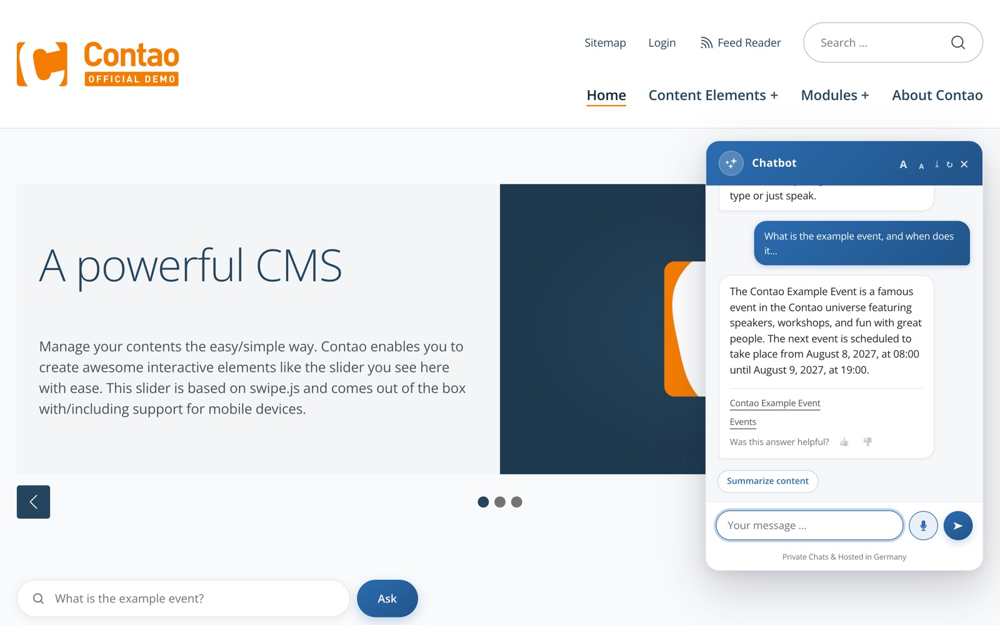
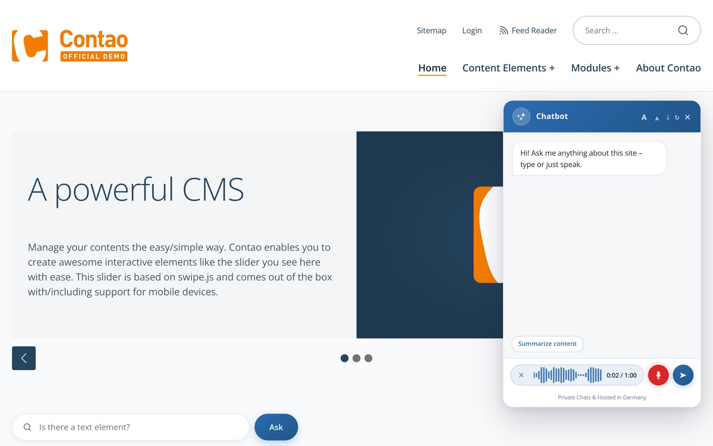
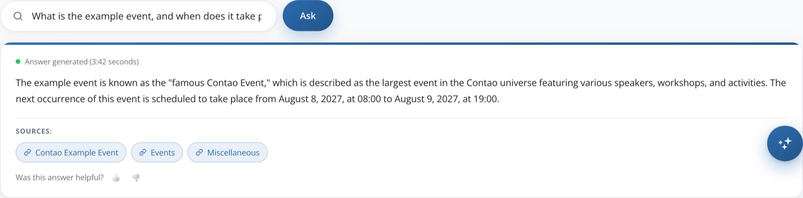
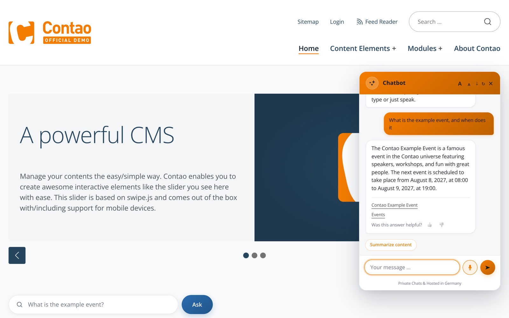
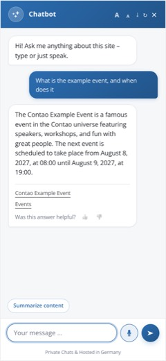

# BlueBranch Chatbot – KI-Chatbot und KI-Suche mit Spracheingabe für Contao (DE)

Dein Website-Assistent für Contao: Besucher tippen oder sprechen ihre Frage und bekommen sofort eine
Antwort – ausschließlich aus deinen eigenen Seiten, mit Quellenangabe.



- **Nur deine Inhalte.** Die KI antwortet aus deinen Seiten und nennt die Quellen als Link.
- **Sprechen statt Tippen.** Mikrofon-Knopf mit Wellenanzeige, die Aufnahme wird nicht gespeichert.
- **Fertiges Design.** Chat-Widget, Frage-Modul und KI-Antwort über der Suche – in deiner Akzentfarbe,
  auch auf dem Smartphone.
- **DSGVO.** Betrieb und Verarbeitung in Deutschland, eigenes KI-Modell ohne OpenAI-Konto, kein
  Training mit deinen Daten, Vertrag nach Art. 28 DSGVO auf Anfrage.
- **Kostenlos starten.** Eine kostenlose Stufe zum Ausprobieren, größere Pakete für mehr Anfragen.

Mehr zum Produkt, zu den Tarifen und zum Datenschutz: [chatbot-dsgvo.de](https://www.chatbot-dsgvo.de/)

Die Erweiterung übergibt die Seiteninhalte beim Suchindex-Lauf an die Chatbot-API, die daraus
eine Vektor-Wissensbasis aufbaut. Aus genau diesem Bestand werden Fragen beantwortet – als
aufklappbares Chat-Widget und als zusammenfassende Antwort über der Trefferliste der
Contao-Suche.

Der API-Schlüssel bleibt dabei auf dem Server: Der Browser spricht ausschließlich mit Contao,
Contao spricht mit der API.


> Stand der Entwicklung und offene ToDos: [docs/stand-und-todos.md](docs/stand-und-todos.md)

## So sieht es aus

| Chat mit Sprachaufnahme | Frage-Modul mit Antwortkarte |
|---|---|
|  |  |

| Eigene Farbe (eine CSS-Variable) | Auf dem Smartphone |
|---|---|
|  |  |

## Erste Schritte im Backend

Unter **BlueBranch Chatbot → Erste Schritte** führt ein Assistent in drei Pflichtschritten zum laufenden Chat:

1. **Zugang verbinden** – Link zur kostenlosen Registrierung, API-Key einfügen, die Verbindung wird sofort geprüft
   (Tarif, Verbrauch, Spracheingabe). Ein abgelehnter Key wird nicht übernommen, ein bisheriger bleibt erhalten.
   Gespeichert wird der Key wie bisher an der Startseite im Seitenbaum; wer mehrere Websites betreibt, wählt oben die Website.
2. **Inhalte trainieren** – zeigt, wie viele Seiten und Zusatzinhalte trainiert sind. **„Jetzt trainieren“** ruft die Seiten der
   Website nacheinander ab (Fortschrittsbalken); dabei indiziert Contao sie und übergibt sie an die API. **„Alles neu trainieren“**
   setzt den Stand zurück und trainiert alle Seiten neu. Der Suchindex-Aufbau bleibt als Alternative.
3. **Chat anzeigen** – ein Klick auf **„Chat auf allen Seiten anzeigen“** setzt das Chat-Widget ohne Layout- und
   Modul-Arbeit in jede Seite ein. Einzelne Seiten nimmt *Chat auf dieser Seite ausblenden* in den Seiteneinstellungen aus;
   ein Widget, das schon im Layout oder Artikel steht, wird nicht doppelt eingesetzt. Die Einstellung steht auch unter
   *System → Einstellungen → Chat auf allen Seiten anzeigen*. Wer lieber selbst platziert, bindet die Module wie gewohnt ein.

Optional folgen **Ausprobieren** (Testfrage direkt im Backend) und **Feinschliff** (Spracheingabe und Feedback als Voreinstellung).
Die Seite ist nur für Administratoren sichtbar.

## So funktioniert die Contao-Integration

Nach der Installation brauchst du nur einen API-Schlüssel – und kannst direkt loslegen:

> Am einfachsten geht es über **BlueBranch Chatbot → Erste Schritte** (siehe oben). Hier die Schritte von Hand:

1. Installation der Erweiterung `$ composer require bluebranch/chatbot` oder über den Contao Manager
2. Registriere Dich auf [chatbot.bluebranch.de](https://chatbot.bluebranch.de)
3. API-Key erstellen und am Startpunkt der Website hinterlegen
4. Suchindex neu aufbauen – damit werden die Inhalte trainiert
5. Frontend-Modul einbinden

Fertig!

## Voraussetzungen

- PHP 8.0 oder neuer
- Contao 4.13 oder 5.x
- Ein Chatbot-Zugang mit API-Schlüssel von [chatbot.bluebranch.de](https://chatbot.bluebranch.de)

## Installation

Über den Contao Manager das Paket `bluebranch/chatbot` hinzufügen, oder per Composer:

```bash
composer require bluebranch/chatbot
```

Anschließend das Contao-Backend einmal aufrufen, damit die Datenbank aktualisiert wird.

## Einrichtung

### 1. API-Schlüssel hinterlegen

Der Schlüssel wird pro Website gesetzt: *Seitenstruktur* → Startpunkt der Website bearbeiten →
Feld **Chatbot API-Key**. In einer Installation mit mehreren Websites bekommt jede ihren eigenen
Schlüssel und damit ihre eigene Wissensbasis.

Ein hinterlegter Schlüssel wird **nie ins Formular geschrieben**. Im Feld steht nur ein
Platzhalter – im Quelltext der Backend-Seite, im Browserverlauf und in jedem Zwischenspeicher
also ebenfalls. `hideInput` zeigt zusätzlich Punkte statt Zeichen.

| Eingabe | Wirkung |
|---|---|
| Platzhalter stehen lassen | Der Schlüssel bleibt |
| Feld leeren | Der Schlüssel wird gelöscht |
| Etwas anderes eintragen | Wird als neuer Schlüssel übernommen |

### 2. Inhalte trainieren

Die Wissensbasis füllt sich über den Contao-Suchindex. Sobald der Crawler läuft
(*System → Suchindex neu aufbauen*), wird jede indizierte Seite an die API übergeben.
**Was nicht im Suchindex steht, kennt der Chatbot nicht.**

> Läuft die Installation im `dev`-Environment, hängt Symfony an jede Antwort einen
> `X-Robots-Tag: noindex`-Header. Der Contao-Crawler überspringt daraufhin sämtliche Seiten, und
> es wird nichts trainiert. Für einen Trainingslauf `APP_ENV=prod` setzen.

### 3. Modul einbinden

Unter *Themes → Frontend-Module* stehen drei Module bereit:

| Modul | Zweck |
|---|---|
| *Chatbot Widget* | Aufklappbarer Chat-Button, standardmäßig unten rechts |
| *Chatbot KI-Suche* | Zusammenfassende KI-Antwort über der Trefferliste der Suche (mit dem Template `_full` mit eigenem Suchfeld) |
| *Chatbot Frage* | Eingabefeld mit getippten Fragen, Antwort direkt darunter |

Alle drei werden wie gewohnt in ein Layout oder einen Artikel eingebunden.

### Getippte Fragen

*Chatbot Frage* und *Chatbot KI-Suche* haben beide das Feld **Getippte Fragen** — eine
Liste beliebig vieler Texte. Sie werden im Frontend nacheinander Zeichen für Zeichen als
Platzhalter ins Eingabefeld geschrieben, gelöscht und durch den nächsten ersetzt. Bleibt die
Liste leer, steht dort der statische Platzhalter.

Die Animation ruht, sobald jemand das Feld anklickt oder etwas hineinschreibt, und im
Hintergrund-Tab läuft sie gar nicht erst. Wer in seinem System *reduzierte Bewegung* eingestellt
hat, sieht statt der Animation die erste Frage unbewegt stehen.

*Chatbot Frage* ist für Startseiten gedacht: Eine eingegebene Frage geht ohne Seitenwechsel an
die KI, die Antwort erscheint samt Quellen direkt darunter — wie beim Such-Modul, nur ohne die
Trefferliste der Contao-Suche.

## Globale Einstellungen

Unter *System → Einstellungen* lassen sich Vorgaben für alle Chat-Widgets setzen. Jedes Modul
kann sie einzeln überschreiben.

| Einstellung | Wirkung |
|---|---|
| Name des Chatbots | Wird im Chat-Header angezeigt |
| Akzentfarbe | Farbe des Widgets, als Hex-Wert mit Farbwähler |
| Icon (SVG) | Ersetzt das Standard-KI-Icon im Chat-Button |
| Standard-Begrüßung | Wird beim ersten Öffnen des Chats angezeigt |
| Standard-Vorschläge | Vorschlagsfragen als Pills über dem Eingabefeld |
| „Inhalt zusammenfassen"-Pill ausblenden | Blendet die Zusammenfassen-Funktion aus |
| Datenschutz-Hinweis ausblenden | Blendet den Hinweis „Private chats & Hosted in Germany" aus |
| Spracheingabe im Chat-Widget anbieten | Vorgabe für das Mikrofon, siehe [Spracheingabe](#spracheingabe-mikrofon); standardmäßig aus |

**Automatische Bereinigung.** Seiten, die nicht mehr veröffentlicht, von der Suche ausgeschlossen
oder über ihr Start-/Stop-Datum abgelaufen sind, gehören nicht in den KI-Index. Ein
zeitgesteuertes Ablaufen passiert ohne Speichern des Datensatzes und würde deshalb sonst nicht
bemerkt. Das Intervall ist wählbar: stündlich, alle 6 Stunden, täglich (Vorgabe) oder wöchentlich.
Der Lauf hängt an Contaos eigenem Cron-System – ein Server-Cronjob ist nicht nötig, es genügt,
dass die Website regelmäßig aufgerufen wird.

**Debug-Dateien.** Standardmäßig aus. Eingeschaltet legt die Erweiterung zu jedem Trainings- und
Löschvorgang eine JSON-Datei unter `var/chatbot/` ab. Das ist zur Fehlersuche gedacht und nicht
für den Dauerbetrieb: Ein Crawler-Lauf erzeugt eine Datei je Seite samt vollständigem Inhalt, und
niemand räumt sie wieder weg.

## Aussehen

Alle Teile – Chat-Widget, Frage-Modul und Suche – kommen **mit fertigem Design** und übernehmen die
**Akzentfarbe** aus *System → Einstellungen* (im Widget je Modul überschreibbar): Verlauf im Kopf des Chats,
Eingabefeld als Pille mit Lupe, Antwortkarte mit Quellen-Pillen, Trefferliste als Karten.
Das Stylesheet lädt die Erweiterung selbst; wer es komplett selbst gestalten will, setzt im Modul
*Kein Standard-Styling*.

Anpassen geht über CSS-Variablen, ohne die Datei der Erweiterung anzufassen:

```css
.chatbot-widget,
.chatbot-ask-container,
.chatbot-generate-search-container {
    --chatbot-widget-accent: #f47c00;          /* Hauptfarbe; Töne und Schein leiten sich davon ab */
    --chatbot-widget-accent-contrast: #1a1a1a; /* Schriftfarbe auf der Hauptfarbe */
    --chatbot-widget-radius: 12px;
    --chatbot-widget-font: "Inter", sans-serif;
}
```

Weitere Variablen: `--chatbot-widget-bg`, `-surface`, `-bubble-bg`, `-text`, `-muted`, `-border`,
`-bot-bubble`, `-gap`, `-z-index`, `-message-font-size`.

## Seiten von den KI-Antworten ausschließen

In den Seiteneinstellungen steht neben *Von der Suche ausschließen* (ab Contao 5.6: *Suchindexierung*) das Feld
**Aus den KI-Antworten ausschließen**. Beide entscheiden dasselbe – ob eine Seite als Quelle
dient – nur für zwei verschiedene Suchen, und sie sind voneinander unabhängig:

| | Contao-Volltextsuche | KI-Antworten |
|---|---|---|
| *Von der Suche ausschließen* | nein | nein |
| *Aus den KI-Antworten ausschließen* | ja | nein |
| beide | nein | nein |

Eine Kontaktseite kann so in der Volltextsuche stehen und trotzdem aus den Chatbot-Antworten
heraus – oder umgekehrt.

**Die Einstellung vererbt sich auf alle Unterseiten.** Wer eine Rubrik abhakt, meint den ganzen
Zweig. Beim Speichern werden die betroffenen Seiten sofort aus der Wissensbasis entfernt, nicht
erst beim nächsten Bereinigungslauf.

## Bereiche vom Index ausnehmen

Zwei Inhaltselemente grenzen Bereiche ab, die nicht in den Suchindex sollen:

- *Suchindex: Bereich ausnehmen – Anfang* (`indexer::stop`) – ab hier wird nicht mehr indiziert
- *Suchindex: Bereich ausnehmen – Ende* (`indexer::continue`) – ab hier wieder; entsteht beim Speichern des Anfangs automatisch dahinter

Für die KI-Wissensbasis werden diese Markierungen bewusst **ignoriert**, damit auch
Nachrichtenlisten und ähnliche dynamische Bereiche beantwortbar bleiben. Sie wirken auf die
klassische Contao-Suche.

## Fragen, Antworten und Feedback

**Speichern:** Unter *System → Einstellungen → Fragen und Antworten* lässt sich einschalten, dass
jede Frage samt Antwort in der Tabelle `tl_chatbot_log` landet – für spätere Auswertungen. Es
wird **keine** IP-Adresse, kein User-Agent und keine Sitzungskennung gespeichert; E-Mail-Adressen,
Telefonnummern und IBANs in Fragen und Kommentaren werden maskiert. Die Aufbewahrung ist
einstellbar (Standard 180 Tage, 0 = unbegrenzt).

**Feedback:** Unter *System → Einstellungen → Fragen, Antworten und Feedback* steht die Vorgabe
*Feedback zu Antworten abfragen*; in jedem Modul (Widget, Frage, Suche) lässt sie sich mit
*Feedback abfragen* auf „An“ oder „Aus“ setzen.
Unter jeder Antwort erscheinen dann 👍/👎; beim Daumen nach unten kann der Besucher kurz angeben,
was nicht gepasst hat (max. 1.000 Zeichen, ohne HTML). Eine bewertete Antwort wird auch dann
samt Frage gespeichert, wenn das Speichern aller Fragen aus ist.

**Ansehen und exportieren:** *BlueBranch Chatbot → Fragen & Feedback* listet die Einträge mit
Filtern (Bewertung, Quelle, Website, Suche), Löschen und **CSV-Export** (UTF-8, Semikolon,
Excel-tauglich; Formeln werden entschärft).

## Chat exportieren und Verlauf

Besucher können ihren Chat über das Download-Symbol im Kopf des Widgets als **Text (.txt)** oder
**WebVTT (.vtt)** herunterladen – die Datei entsteht im Browser. Der Verlauf im `localStorage`
enthält jetzt auch die Antworten samt Quellen und Bewertung; eine Antwort, die beim Seitenwechsel
noch lief, steht danach mit dem Hinweis „Antwort unterbrochen“ da.

## Spracheingabe (Mikrofon)

Im Chat-Widget, im Frage-Modul und in der Suche kann ein Mikrofon-Knopf stehen (im Widget neben dem Senden-Knopf, im Frage-Modul und in der
Suche rechts im Eingabefeld). Besucher sprechen ihre Frage,
die Aufnahme wird in Text umgewandelt und wie eine getippte Frage gesendet – mit Antwort, Quellen,
Feedback und Verlauf wie gewohnt.

**Einschalten.** Unter *System → Einstellungen → Spracheingabe im Chat-Widget anbieten* gilt die
Vorgabe für alle Module (standardmäßig **aus**). In jedem Modul – Chat-Widget, Frage-Modul und Suche – lässt sie
sich mit *Spracheingabe (Mikrofon)* auf „An“ oder „Aus“ setzen, so lässt sich das Mikrofon auch nur an einzelnen
Modulen anbieten oder an einzelnen abschalten.

**Frage-Modul und Suche.** Im Frage-Modul geht die gesprochene Frage nach dem Erkennen sofort ab; die Antwort erscheint
darunter. In der Suche gilt das für die Variante mit eigenem Suchfeld (Template `mod_chatbot_generate_search_full`): Der
erkannte Text startet die Suche wie ein getipptes Stichwort. Die Variante, die nur die KI-Antwort über der Trefferliste des
Contao-Suchmoduls einfügt, hat kein eigenes Feld und deshalb kein Mikrofon. Angepasste Templates brauchen den Knopf
`.chatbot-voice-btn` im Feld und `voice` in der Konfiguration – am einfachsten aus dem Template der Erweiterung übernehmen.

**Wann der Knopf erscheint.** Alle drei Bedingungen müssen zutreffen:

1. Das Modul erlaubt die Spracheingabe (siehe oben).
2. Die API hat die Spracherkennung für den Zugang eingerichtet (`transcriptionEnabled` in
   `GET /user/me/tier`). Das Ergebnis wird zehn Minuten zwischengespeichert; bei einem Fehler der
   API eine Minute.
3. Die Seite läuft über **HTTPS** (oder `localhost`) und der Browser kann aufnehmen
   (`MediaRecorder`) – sonst bleibt der Knopf verborgen.

**Bedienung.** Ein Klick startet die Aufnahme, der nächste beendet sie und sendet. Während der
Aufnahme zeigt eine Leiste Wellen nach Lautstärke und die Zeit; mit × oder Escape wird die Aufnahme
verworfen. Die Aufnahme endet von selbst nach der längsten erlaubten Dauer des Zugangs (Free 10 s,
Pro 30 s, Expert 60 s). Wurde es durchgehend still, geht nichts an die API und es erscheint „Es
wurde nichts verstanden“ – Whisper erfindet bei Stille sonst gern Sätze.

**Kontingent.** Eine gesprochene Frage zählt **zweimal** zum Anfragekontingent: einmal für die
Umwandlung, einmal für die Antwort.

**Technik.** Der Browser schickt die Aufnahme an `POST /bluebranch/chatbot/api/v1/transcribe`. Die
Route prüft Sitzungs-Token, Signatur von Seite und Modul, die Modul-Einstellung, ein Ratenlimit
(20 je Minute und Client) und die Größe (4 MB) und reicht die Aufnahme mit dem API-Schlüssel an
`POST /chatbot-ai/transcribe` weiter. Der Schlüssel bleibt auf dem Server.

## Zusatzinhalte

*BlueBranch Chatbot → Zusatzinhalte* nimmt Inhalte ohne eigene Seite auf: **Texte** für
Meta-Infos (Öffnungszeiten, Ansprechpartner, Hinweise) und **Dateien** (TXT, MD, CSV, PDF, DOCX,
ODT, HTML; max. 20 MB). Der Text wird auf dem eigenen Server ausgelesen (PDF über
`smalot/pdfparser`), an die API geht **nur Text** – nie die Datei – und keine URL. Solche Inhalte
erscheinen deshalb nicht als Link unter den Antworten. Speichern überträgt, Deaktivieren und
Löschen entfernt; eine im Dateimanager ersetzte Datei wird automatisch neu übertragen.

## Zeitgesteuerte Inhalte

Läuft eine Seite, ein Artikel oder ein Inhaltselement über *Anzeigen ab/bis* an oder ab, prüft
ein Cronjob das alle 15 Minuten: Nicht mehr sichtbare Seiten verlassen sofort den KI-Index, bei
geänderten Seiten wird die Seite einmal abgerufen und neu trainiert. Vorher geschah das erst beim
nächsten Besuch der Seite bzw. beim täglichen Bereinigungslauf. Der Abruf braucht, dass der
Server seine eigene Domain erreicht; sonst bleibt es beim nächsten Besuch.

## Trainierte Inhalte einsehen

Das Backend-Modul *BlueBranch Chatbot → Trainierte Inhalte* zeigt, was die Wissensbasis
tatsächlich enthält – je Website, mit Titel, URL, Anzahl der Chunks, Sprache und Trainingsdatum.
Einzelne Einträge oder der gesamte Bestand lassen sich dort löschen. Über das eingebaute
Test-Feld kannst du dem Chatbot direkt eine Frage stellen und die Antwort samt Quellen prüfen,
ohne die Website zu öffnen.

## Nutzungsstufen

Ein Zugang ist **Free**, **Pro** oder **Expert**. Die Stufen unterscheiden sich im
Anfragekontingent der Antwort-Routen – je Minute und je Kalendermonat –, in der Zahl der Projekte
und in der Länge einer Sprachaufnahme; Inhalte trainieren, Inhalte auflisten und API-Keys anlegen
ist in allen Stufen unbegrenzt. **Pro und Expert** bucht der Inhaber des Zugangs selbst als
Monatsabo über Stripe im Chatbot-Frontend (https://chatbot.bluebranch.de) – in dieser Erweiterung
gibt es dafür keinen Bezahlweg.

Die konkreten Zahlen stehen bewusst **nicht** in dieser Erweiterung. Sie kommen zur Laufzeit von
der API, zusammen mit einem fertigen Hinweistext. Ändert sich das Kontingent, ändert sich die
Anzeige mit – ohne dass eine neue Fassung der Erweiterung ausgeliefert werden muss. Die aktuelle
Stufe steht samt Verbrauch im laufenden Monat im Backend unter *BlueBranch Chatbot → Trainierte
Seiten* oben auf der Seite.

Ist das Kontingent erschöpft, antwortet die API mit **HTTP 429** und nennt in `reason` den Grund.
Besucher sehen dann eine neutrale Meldung: beim Minutenlimit (`rate_limit`), sie sollten es gleich
noch einmal versuchen, beim Monatskontingent (`monthly_quota`), später. Der ausführliche Grund samt
Stufe landet im Log der Contao-Installation und nicht im Chatfenster.

**Pausierte Projekte.** Nach einem Abstieg (etwa Kündigung des Abos) bleiben alle Projekte
erhalten, überzählige sind pausiert. Die API antwortet für sie mit **HTTP 403** und
`reason: project_paused`; Besucher lesen „Der Chat steht im Moment nicht zur Verfügung“. Welche
Projekte aktiv bleiben, wählt der Inhaber im Chatbot-Frontend.

## Wie die Anfragen laufen

Der Browser ruft ausschließlich Contao-Routen auf, die ihrerseits die API ansprechen:

| Route | Aufgabe |
|---|---|
| `/bluebranch/chatbot/api/v1/chat/stream` | Antwort im Chat-Modus (kurz, schnell) |
| `/bluebranch/chatbot/api/v1/generate/stream` | Antwort im Such-Modus (ausführlich) |
| `/bluebranch/chatbot/api/v1/generate/search` | Antwort ohne Streaming |

Alle drei verlangen einen Sitzungs-Token. Die Module holen ihn erst bei der ersten Frage über
`POST /bluebranch/chatbot/api/v1/token` – Seiten mit Chatbot kommen so ohne Session aus und
bleiben im HTTP-Cache. Frage und Token gehen per POST im Rumpf bzw. Header, nicht in der URL. Die
Antworten kommen als Server-Sent Events zurück: zuerst ein `sources`-Ereignis mit den verwendeten
Seiten, danach die Antwort in Stücken, zum Schluss ein `end`-Ereignis.

Wird die Erweiterung hinter einem Reverse Proxy betrieben, muss dieser das Puffern für diese
Routen abschalten (`proxy_buffering off` bei nginx) – sonst kommt die Antwort erst am Stück und
der Streaming-Effekt entfällt.

## Aktualisieren

Nach dem Einspielen einer neuen Fassung sind **zwei** Schritte nötig, sonst ändert sich nichts:

1. *System-Wartung* → **Anwendungscache leeren**
2. *System-Wartung* → **Datenbank aktualisieren**

Per Konsole:

```bash
composer dump-autoload                                   # nur bei Installation über Composer
php vendor/bin/contao-console cache:clear --env=prod
php vendor/bin/contao-console contao:migrate
```

> **Ohne Schritt 1 sieht es aus, als sei nichts angekommen.** Contao kompiliert seinen
> Dienst-Container nach `var/cache/prod/` und liest ihn danach nur noch. Eine neu hochgeladene
> Klasse existiert für die Anwendung schlicht nicht: Ihre Callbacks werden nicht registriert,
> Felder erscheinen weiter wie zuvor – und es gibt keine Fehlermeldung, denn für Contao ist alles
> in Ordnung.
>
> Ob eine Klasse angekommen ist, zeigt
> `php vendor/bin/contao-console debug:container ApiKeyFieldListener --env=prod` – die Zeile
> *Tags* muss `contao.callback` nennen.

> **Die Befehle als Webserver-Benutzer ausführen**, meist `www-data`. Als `root` gestartet gehört
> das neu angelegte Cache-Verzeichnis hinterher root, der Webserver kann nicht mehr
> hineinschreiben, und die Website antwortet nur noch mit 500 – ohne Eintrag im Anwendungslog,
> weil der Fehler vor dem Framework passiert. Über den Contao Manager kann das nicht schiefgehen.

### Ältere Versionen und angepasste Templates

Die Erweiterung läuft mit **Contao 4.13 und 5.x** (PHP 8.0 oder neuer). Beim Update bleibt alles lauffähig, auch wenn ein Schritt
fehlt: Fehlen die neuen Datenbankfelder noch (vor *Datenbank aktualisieren*), liefern die Seiten normal aus, nur die neuen Schalter
sind erst nach der Migration speicherbar.

Eigene Kopien der Templates unter `templates/mod_chatbot_*.html5` ersetzen die der Erweiterung und werden vom Update **nicht**
mitgezogen. Der Code bleibt rückwärtskompatibel dazu (getestet gegen die Templates von 1.3.0, 1.4.1 und 1.5.1):

| Template stammt aus | Verhalten mit der aktuellen Erweiterung |
|---|---|
| 1.5.x | funktioniert; Frage-Modul und Suche ohne Mikrofon-Knopf |
| 1.3.x und 1.4.x | funktioniert; ohne Mikrofon-Knopf, ohne neues Design (bei Frage und Suche), Widget-Text kann im Suchindex landen |
| älter als 1.3.0 | **Chat antwortet nicht** („Bitte laden Sie die Seite neu“): Die Signatur von Seite und Modul fehlt, sie ist seit 1.3.0 Pflicht |

*BlueBranch Chatbot → Erste Schritte* prüft die Projekt-Templates und nennt, welche veraltet sind und was ihnen fehlt; bei fehlender
Signatur steht zusätzlich ein Fehler im Anwendungslog. Am einfachsten: die eigene Kopie löschen (dann gilt das Template der Erweiterung)
oder neu aus `vendor/bluebranch/chatbot/src/Resources/contao/templates/` kopieren und anpassen.

## Datenschutz und Hosting

- **Hosting in Deutschland.** Server und Datenverarbeitung liegen ausschließlich in Deutschland.
- **Eigenes KI-Modell.** Die KI läuft auf eigener Infrastruktur. Deine Inhalte gehen nicht an
  OpenAI, Anthropic oder andere Drittanbieter.
- **Kein Training mit deinen Daten.** Weder Seiteninhalte noch Chatverläufe werden zum Trainieren
  von Modellen verwendet.
- **Auftragsverarbeitungsvertrag.** Ein AVV nach Art. 28 DSGVO ist möglich – auf Anfrage per
  E-Mail an lb@bluebranch.de.
- **Der API-Schlüssel bleibt auf dem Server.** Der Browser spricht ausschließlich mit Contao und
  bekommt den Schlüssel zu keinem Zeitpunkt zu sehen.
- **Spracheingabe (nur wenn eingeschaltet).** Die Aufnahme geht über Contao an die API und wird dort
  im Arbeitsspeicher in Text umgewandelt; sie wird weder in Contao noch in der API gespeichert,
  weder Audio noch Text kommen ins Log. Der Browser fragt vor der ersten Aufnahme selbst nach der
  Erlaubnis für das Mikrofon. Bitte in der Datenschutzerklärung der Website erwähnen.

## Vorteile für Redakteur:innen und Entwickler

- Antworten aus dem eigenen Bestand: Die KI erfindet nichts, sie zitiert deine Seiten – mit Quellenangabe
- Kein separates Tool: Wissensbasis, Widget und Auswertung liegen im Contao-Backend
- Der API-Schlüssel verlässt den Server nie – der Browser sieht ihn zu keinem Zeitpunkt
- Redaktionelle Kontrolle: Einzelne Seiten und ganze Zweige lassen sich von den Antworten ausnehmen
- Kein Server-Cronjob nötig: Die Bereinigung läuft über Contaos eigenes Cron-System
- DSGVO-konform: Verarbeitung ausschließlich in Deutschland, eigenes KI-Modell, AVV möglich

# BlueBranch Chatbot – AI chat and AI search with voice input for Contao (EN)

Your website assistant for Contao: visitors type or speak their question and get an answer right away –
drawn only from your own pages, with sources.


- **Only your content.** The AI answers from your pages and links the sources.
- **Speak instead of typing.** Microphone button with live waveform; the recording is not stored.
- **Ready-made design.** Chat widget, question module and AI answer above the search – in your accent
  colour, also on smartphones.
- **GDPR.** Hosted and processed in Germany, our own AI model without an OpenAI account, no training
  with your data, agreement under Art. 28 GDPR on request.
- **Start for free.** A free tier to try it out, larger plans for more requests.

More about the product, plans and data protection: [chatbot-dsgvo.de](https://www.chatbot-dsgvo.de/)

During the search index run, the extension hands your page content to the Chatbot API, which
builds a vector knowledge base from it. Questions are answered from exactly that content – as a
collapsible chat widget and as a summarising answer above the Contao search results.

The API key stays on the server: the browser only ever talks to Contao, and Contao talks to the
API.

## What it looks like

| Chat with voice recording | Question module with answer card |
|---|---|
|  |  |

| Your own colour (one CSS variable) | On a smartphone |
|---|---|
|  |  |

## Getting started in the back end

Under **BlueBranch Chatbot → Getting started** an assistant leads to a running chat in three required steps:

1. **Connect your account** – link to the free registration, paste the API key, the connection is checked right away
   (plan, usage, voice input). A rejected key is not kept; a previous key stays. The key is stored on the root page in the
   site tree as before; with several websites you pick the website at the top.
2. **Train your content** – shows how many pages and additional contents are trained. **"Train now"** fetches the pages of the
   website one after another (progress bar); Contao indexes them and hands them to the API. **"Retrain everything"** resets the
   state and trains all pages again. The search index rebuild stays available as an alternative.
3. **Show the chat** – one click on **"Show chat on all pages"** puts the chat widget into every page without layout or
   module work. Single pages are excluded with *Hide chat on this page* in the page settings; a widget that is already in a
   layout or article is not inserted twice. The setting is also under *System → Settings → Show chat on all pages*. If you
   prefer to place it yourself, add the modules as usual.

Optional: **Try it out** (a test question right in the back end) and **Fine-tuning** (voice input and feedback as defaults).
The page is visible to administrators only.

## How the Contao Integration Works

After installation, all you need is an API key – and you are ready to go:

1. Install the extension using `$ composer require bluebranch/chatbot` or via the Contao Manager
2. Register at [chatbot.bluebranch.de](https://chatbot.bluebranch.de)
3. Generate your API key and store it on the website's root page
4. Rebuild the search index – this trains your content
5. Add a front end module

That's it!

## Requirements

- PHP 8.0 or newer
- Contao 4.13 or 5.x
- A chatbot account with an API key from [chatbot.bluebranch.de](https://chatbot.bluebranch.de)

## Setup

### 1. Store the API key

The key is set per website: *Site structure* → edit the website's root page → field
**Chatbot API-Key**. In an installation with several websites, each one gets its own key and
therefore its own knowledge base.

A stored key is **never written into the form**. The field only ever contains a placeholder – in
the backend page source, in the browser history and in any cache as well. `hideInput`
additionally shows dots instead of characters.

| Input | Effect |
|---|---|
| Leave the placeholder | The key is kept |
| Empty the field | The key is deleted |
| Enter something else | It is stored as the new key |

### 2. Train your content

The knowledge base is filled through the Contao search index. As soon as the crawler runs
(*System → Rebuild the search index*), every indexed page is passed to the API.
**Whatever is not in the search index is unknown to the chatbot.**

> If the installation runs in the `dev` environment, Symfony adds an `X-Robots-Tag: noindex`
> header to every response. The Contao crawler then skips all pages and nothing is trained. Set
> `APP_ENV=prod` for a training run.

### 3. Add a module

Two front end modules are available under *Themes → Front end modules*:

| Module | Purpose |
|---|---|
| *Chatbot Widget* | Collapsible chat button, bottom right by default |
| *Chatbot AI search* | Summarising AI answer above the search results (with the `_full` template with its own search field) |
| *Chatbot Question* | Input field with typed questions, answer right below it |

All three are added to a layout or an article as usual.

### Typed questions

*Chatbot Question* and *Chatbot AI search* both offer the **Typed questions** field — a list
of as many texts as you like. In the front end they are written into the input field as a
placeholder, one character at a time, then deleted and replaced by the next one. If the list stays
empty, the static placeholder remains.

The animation pauses as soon as somebody clicks into the field or types something, and it does not
run at all in a background tab. Anyone who has *reduced motion* enabled on their system sees the
first question standing still instead of the animation.

*Chatbot Question* is meant for home pages: a question is sent to the AI without a page reload and
the answer appears right below it, sources included — like the search module, only without the
Contao search results.

## Global settings

Defaults for all chat widgets are set under *System → Settings*. Every module can override them
individually.

| Setting | Effect |
|---|---|
| Chatbot name | Shown in the chat header |
| Accent colour | Colour of the widget, as a hex value with colour picker |
| Icon (SVG) | Replaces the default AI icon in the chat button |
| Default greeting | Shown when the chat is opened for the first time |
| Default suggestions | Suggested questions as pills above the input field |
| Hide "summarise content" pill | Hides the summarise function |
| Hide privacy note | Hides the "Private chats & Hosted in Germany" note |
| Offer voice input in the chat widget | Default for the microphone, see [Voice input](#voice-input-microphone); off by default |

**Automatic clean-up.** Pages that are no longer published, excluded from the search or expired
via their start/stop date do not belong in the AI index. Expiry by date happens without the
record being saved and would otherwise go unnoticed. The interval is configurable: hourly, every
6 hours, daily (default) or weekly. The run hooks into Contao's own cron system – no server
cronjob is required, it is enough that the website is visited regularly.

**Debug files.** Off by default. When enabled, the extension writes a JSON file to `var/chatbot/`
for every training and deletion operation. This is meant for troubleshooting, not for permanent
operation: one crawler run produces a file per page including its full content, and nothing ever
cleans them up.

## Appearance

The chat widget, the question module and the search all ship with a **finished design** and pick up the
**accent colour** from *System → Settings* (overridable per module in the widget): gradient header, pill-shaped
input with a magnifier, answer card with source pills, result list as cards. The extension loads its own
stylesheet; to style everything yourself, tick *No default styling* in the module.

Customise with CSS variables without touching the extension's file:

```css
.chatbot-widget,
.chatbot-ask-container,
.chatbot-generate-search-container {
    --chatbot-widget-accent: #f47c00;          /* main colour; tints and glow are derived from it */
    --chatbot-widget-accent-contrast: #1a1a1a; /* text colour on the main colour */
    --chatbot-widget-radius: 12px;
    --chatbot-widget-font: "Inter", sans-serif;
}
```

More variables: `--chatbot-widget-bg`, `-surface`, `-bubble-bg`, `-text`, `-muted`, `-border`, `-bot-bubble`,
`-gap`, `-z-index`, `-message-font-size`.

## Excluding pages from AI answers

Next to *Exclude from search* (Contao 5.6 and later: *Search indexing*) the page settings offer **Exclude from AI answers**. Both decide
the same thing – whether a page serves as a source – but for two different searches, and they are
independent of each other:

| | Contao full text search | AI answers |
|---|---|---|
| *Exclude from search* | no | no |
| *Exclude from AI answers* | yes | no |
| both | no | no |

A contact page can therefore appear in the full text search and still stay out of the chatbot
answers – or the other way round.

**The setting is inherited by all subpages.** Ticking a section means the whole branch. On saving,
the affected pages are removed from the knowledge base immediately, not only at the next clean-up
run.

## Excluding areas from the index

Two content elements delimit areas that should stay out of the search index:

- *Search index: exclude area – start* (`indexer::stop`) – nothing is indexed from here on
- *Search index: exclude area – end* (`indexer::continue`) – indexing resumes; created automatically behind the start when you save it

These markers are deliberately **ignored** for the AI knowledge base, so that news lists and
similar dynamic areas remain answerable. They apply to the classic Contao search.

## Questions, answers and feedback

- **Storing** (*System → Settings → Questions and answers*): every question and answer is saved to
  `tl_chatbot_log` – no IP address, user agent or session ID; e-mail addresses, phone numbers and
  IBANs are masked. Retention is configurable (default 180 days).
- **Feedback** (checkbox *Ask for feedback* in each module): 👍/👎 below every answer, a short
  comment on 👎. A rated answer is stored even when storing is switched off.
- **Back end** *BlueBranch Chatbot → Questions & feedback*: filters, deletion and CSV export.
- **Chat export**: visitors download their chat as `.txt` or `.vtt`. Answers now survive page
  changes in the browser history.
- **Additional content** (*BlueBranch Chatbot → Additional content*): texts and files (TXT, MD,
  CSV, PDF, DOCX, ODT, HTML) are converted to text locally; only text is sent to the API, never a
  file and never a URL.
- **Scheduled content**: a cron job (every 15 minutes) removes expired pages and refreshes pages
  whose articles or content elements started or stopped.

## Voice input (microphone)

The chat widget can show a microphone button next to the send button. Visitors speak their
question, the recording is converted to text and sent like a typed question – with answer,
sources, feedback and history as usual.

- **Switching it on:** *System → Settings → Offer voice input in the chat widget* is the default for
  all modules (**off** by default). Each module – chat widget, question module and search – can set *Voice input
  (microphone)* to "On" or "Off", so the microphone can be offered on selected modules only or switched off on single ones.
- **Question module and search:** in the question module the spoken question is sent right after recognition and the answer
  appears below. In the search this applies to the variant with its own search field (template
  `mod_chatbot_generate_search_full`): the recognised text starts the search like a typed keyword. The variant that only adds
  the AI answer above the results of the Contao search module has no field of its own and therefore no microphone. Customised
  templates need the `.chatbot-voice-btn` button in the field and `voice` in the configuration – easiest is to copy them from
  the extension's templates.
- **When the button appears:** the module allows it, the API has speech recognition set up for the
  account (`transcriptionEnabled` in `GET /user/me/tier`, cached for ten minutes), and the page is
  served over **HTTPS** (or `localhost`) in a browser that can record.
- **Using it:** one click starts recording, the next stops and sends. While recording, a bar shows
  waves by loudness and the time; × or Escape discards the recording. It ends by itself after the
  longest duration the account allows (Free 10 s, Pro 30 s, Expert 60 s). If it stayed silent
  throughout, nothing is sent to the API.
- **Quota:** a spoken question counts **twice** towards the request quota (transcription and
  answer).
- **How it works:** the browser posts the recording to
  `POST /bluebranch/chatbot/api/v1/transcribe`. The route checks session token, page/module
  signature, the module setting, a rate limit (20 per minute and client) and the size (4 MB) and
  forwards it with the API key to `POST /chatbot-ai/transcribe`. The key stays on the server.

## Reviewing trained content

The back end module *BlueBranch Chatbot → Trained pages* shows what the knowledge base actually
contains – per website, with title, URL, number of chunks, language and training date. Individual
entries or the entire stock can be deleted there. The built-in test field lets you ask the chatbot
a question and check the answer including its sources without opening the website.

## Usage tiers

An account is **Free**, **Pro** or **Expert**. The tiers differ in the request quota of the answer
routes – per minute and per calendar month –, in the number of projects and in the length of a voice
recording; training content, listing content and creating API keys is unlimited in every tier.
**Pro and Expert** are booked by the account owner as a monthly subscription through Stripe in the
chatbot frontend (https://chatbot.bluebranch.de) – this extension has no payment path.

The actual numbers deliberately do **not** live in this extension. They come from the API at
runtime, together with a ready-made note. If the quota changes, the display changes with it – no
new release of the extension required. The current tier and this month's usage are shown under
*BlueBranch Chatbot → Trained pages* at the top of the page.

Once the quota is exhausted, the API answers with **HTTP 429** and names the cause in `reason`.
Visitors then see a neutral message: try again shortly after the per-minute limit (`rate_limit`),
try again later once the monthly quota is used up (`monthly_quota`). The detailed reason including
the tier goes to the log of the Contao installation, not into the chat window.

**Paused projects.** After a downgrade (e.g. a cancelled subscription) all projects are kept, surplus
ones are paused. The API answers for them with **HTTP 403** and `reason: project_paused`; visitors
read "The chat is currently unavailable". The account owner picks the active projects in the
chatbot frontend.

## How the requests work

The browser only ever calls Contao routes, which in turn talk to the API:

| Route | Purpose |
|---|---|
| `/bluebranch/chatbot/api/v1/chat/stream` | Answer in chat mode (short, fast) |
| `/bluebranch/chatbot/api/v1/generate/stream` | Answer in search mode (detailed) |
| `/bluebranch/chatbot/api/v1/generate/search` | Answer without streaming |

All three require a session token. The modules only fetch it with the first question via
`POST /bluebranch/chatbot/api/v1/token`, so pages with a chatbot need no session and stay in the
HTTP cache. Question and token are sent via POST in the body and header, not in the URL. Answers
come back as server-sent events: first a `sources` event listing the pages used, then the answer
in chunks, and finally an `end` event.

When running behind a reverse proxy, buffering has to be switched off for these routes
(`proxy_buffering off` for nginx) – otherwise the answer arrives in one piece and the streaming
effect is lost.

## Updating

After installing a new release, **two** steps are required, otherwise nothing changes:

1. *System maintenance* → **Purge the application cache**
2. *System maintenance* → **Update database**

On the command line:

```bash
composer dump-autoload                                   # only when installed via Composer
php vendor/bin/contao-console cache:clear --env=prod
php vendor/bin/contao-console contao:migrate
```

> **Without step 1 it looks as if nothing arrived.** Contao compiles its service container into
> `var/cache/prod/` and only reads it from then on. A freshly uploaded class simply does not exist
> for the application: its callbacks are not registered, fields still look the way they did – and
> there is no error message, because as far as Contao is concerned everything is fine.
>
> `php vendor/bin/contao-console debug:container ApiKeyFieldListener --env=prod` shows whether a
> class arrived – the *Tags* line has to mention `contao.callback`.

> **Run the commands as the web server user**, usually `www-data`. Started as `root`, the newly
> created cache directory ends up owned by root, the web server can no longer write to it, and the
> website answers with 500 only – without an entry in the application log, because the error
> happens before the framework. This cannot go wrong via the Contao Manager.

### Older versions and customised templates

The extension runs with **Contao 4.13 and 5.x** (PHP 8.0 or newer). An update stays functional even if a step is missing: while the new
database fields are not there yet (before *Update database*), the pages render normally; the new switches just cannot be saved before
the migration.

Your own copies of the templates under `templates/mod_chatbot_*.html5` replace the extension's and are **not** carried along by an
update. The code stays backwards compatible with them (tested against the templates of 1.3.0, 1.4.1 and 1.5.1):

| Template comes from | Behaviour with the current extension |
|---|---|
| 1.5.x | works; question module and search without microphone button |
| 1.3.x and 1.4.x | works; without microphone button, without the new design (question and search), widget text can end up in the search index |
| older than 1.3.0 | **chat does not answer** ("Please reload the page"): the page/module signature is missing, mandatory since 1.3.0 |

*BlueBranch Chatbot → Getting started* checks the project templates and names the outdated ones and what they lack; a missing signature
also leaves an error in the application log. Simplest: delete your copy (the extension's template applies then) or copy it again from
`vendor/bluebranch/chatbot/src/Resources/contao/templates/` and re-apply your changes.

## Data protection and hosting

- **Hosted in Germany.** Servers and data processing are located in Germany only.
- **Our own AI model.** The AI runs on our own infrastructure. Your content is not passed on to
  OpenAI, Anthropic or any other third party.
- **No training on your data.** Neither page content nor chat histories are used to train models.
- **Data processing agreement.** A DPA under Art. 28 GDPR is available on request by e-mail to
  lb@bluebranch.de.
- **The API key stays on the server.** The browser only ever talks to Contao and never gets to see
  the key.
- **Voice input (only if switched on).** The recording goes through Contao to the API and is
  converted to text in memory there; it is stored neither in Contao nor in the API, and neither
  audio nor text reach any log. The browser itself asks for microphone permission before the first
  recording. Please mention it in your site's privacy policy.

## Benefits for editors and developers

- Answers from your own content: the AI invents nothing, it quotes your pages – with sources
- No separate tool: knowledge base, widget and review all live in the Contao back end
- The API key never leaves the server – the browser never sees it
- Editorial control: individual pages and whole branches can be excluded from answers
- No server cronjob required: clean-up runs through Contao's own cron system
- GDPR-friendly: processing in Germany only, our own AI model, DPA available

## Vielen Dank

Unser Team dankt für die Unterstützung und das Benutzen vom BlueBranch Chatbot.

Das Team von [www.bluebranch.de](https://www.bluebranch.de/)

<3

## Lizenz

MIT – siehe [LICENSE.txt](LICENSE.txt).

## Changes

### 1.8.4 - 2026-10-30

- Link auf die Produktseite [chatbot-dsgvo.de](https://www.chatbot-dsgvo.de/) im README und als Homepage bei Packagist
- Keine Änderung am Code

### 1.8.3 - 2026-10-30

- **Mehrsprachige Seiten:** Hat die Startseite einer Sprache keinen eigenen API-Key, gilt der Key einer Startseite derselben Domain
  (die Fallback-Sprache zuerst). Bisher blieb das Widget in neu angelegten Sprachen unsichtbar, die Seiten kamen nicht in den Index
- **Quellen in der Sprache der Seite:** Auf mehrsprachigen Seiten (Chat, Frage-Modul, Suche) erscheinen nur Quellen derselben Sprache.
  Einsprachige Installationen sind nicht betroffen
- Nach dem Update: `composer update`, Cache leeren

### 1.8.2 - 2026-10-30

- **Vorschlags-Pillen im Chat-Widget** lassen sich mit der Maus ziehen (Drag & Drop), die Leiste bleibt ohne Scrollbar; ein Klick direkt nach
  dem Ziehen löst keine Pille aus. Auf Touch-Geräten scrollt sie wie bisher per Wisch
- **Eingabefeld im Chat-Widget** zeigt keine Scrollbar mehr: Die automatische Höhe rechnet den Rand mit, gescrollt wird erst ab 120 px
- Nach dem Update: `composer update`, Cache leeren

### 1.8.1 - 2026-10-30

- **Fix:** Der Assistent *Erste Schritte* brach beim Einschalten von „Chat auf allen Seiten“ mit „Unknown column 'tl_theme.1'“ ab, wenn
  noch kein Chatbot-Modul existierte (`GlobalWidget::createModule()` suchte das Theme mit `findOneBy('1', '1')`)
- **Name und Akzentfarbe** werden in Schritt 3 von *Erste Schritte* abgefragt (Farbwähler und Hex-Feld) und beim Einschalten des Chats
  mitgespeichert; bei aktivem Chat gibt es dafür einen eigenen Speichern-Knopf. Die Werte sind dieselben wie unter *System → Einstellungen*
- **Bestätigungen als Toast:** Erfolgsmeldungen in *Erste Schritte* (Key gespeichert, Chat an/aus, Voreinstellungen, Training fertig) erscheinen
  als Contao-Toast; Fehler und Warnungen bleiben als Hinweis in der Seite
- **Freigabe für Benutzer und Gruppen:** *Erste Schritte* und *Trainierte Inhalte* sind nicht mehr auf Administratoren beschränkt, sondern
  über die Backend-Module in den Benutzer- und Gruppenrechten freigebbar (neu: `BackendAccess`); ebenso das Training, die Test-Frage und das
  Löschen trainierter Inhalte
- *Trainierte Seiten* heißt jetzt *Trainierte Inhalte*
- Nach dem Update: `composer update`, Cache leeren

### 1.8.0 - 2026-10-29

- **„Jetzt trainieren“ in *Erste Schritte*:** Ein Klick ruft die Seiten der Website in Portionen ab (Fortschrittsbalken, Abbruch bei Fehlern
  mit Meldung); Contao indiziert sie, der Index-Hook trainiert. „Alles neu trainieren“ setzt den Stand zurück. Neu: `PageFetcher`,
  `StartTrainController` (nur Administratoren, Token-geschützt). Bei fester Domain wird die URL aus Domain und Schema gebaut, Weiterleitungen
  auf andere Hosts gelten als Fehler
- **Link zum Portal** (chatbot.bluebranch.de) im Kopfbanner und in Schritt 1 von *Erste Schritte*
- **Texte in Sprachdateien:** *Erste Schritte* liest alle Texte aus `chatbot_start` (Deutsch und Englisch, 97 Schlüssel), ebenso die Meldungen
  der Template-Prüfung und der Verbindungsprüfung
- Getestet in Chrome, Brave und der WebKit-Engine (Safari-Äquivalent) mit simuliertem Mikrofon
- Nach dem Update: `composer update`, Cache leeren

### 1.7.0 - 2026-10-29

- **Spracheingabe auch im Frage-Modul und in der Suche:** Mikrofon-Knopf rechts im Eingabefeld, Wellen ersetzen bei der Aufnahme
  das Feld (× oder Escape verwirft), der erkannte Text geht sofort als Frage bzw. Suche ab. In der Suche nur in der Variante mit
  eigenem Suchfeld (`mod_chatbot_generate_search_full`). Das Feld *Spracheingabe (Mikrofon)* steht jetzt in allen drei Modultypen
  und folgt der Vorgabe aus den Einstellungen. Nach dem Update Seitencache leeren; angepasste Templates brauchen den Knopf
  `.chatbot-voice-btn` im Feld und `voice` in der Konfiguration. Neu: `ChatbotVoiceField` in `chatbot-common.js`,
  `VoiceInput::forModule()`
- **Backend-Masken überarbeitet:** Das Chat-Widget gruppiert seine Felder in *Aussehen*, *Texte* und *Funktionen*; Frage-Modul und Suche
  zeigen *Funktionen* und legen „Kein Standard-Styling“ zum Template. Die Such-Maske erklärt die zwei Varianten (mit und ohne eigenes Suchfeld).
  Der Modultyp heißt jetzt *Chatbot KI-Suche* (bisher „Chatbot Generate Search“). Die Hilfetexte sind kürzer und werden nicht mehr abgeschnitten.
  Die Einstellungen sind in *Einrichtung*, *Aussehen* und *Texte und Hinweise* geteilt und verweisen auf *Erste Schritte*
- **Inhaltselemente:** Die Indexer-Elemente heißen *Suchindex: Bereich ausnehmen – Anfang/Ende*, zeigen nur noch Typ und Sichtbarkeit
  (keine Template-, Zugriffs- und Experten-Felder) und sagen, dass die KI-Wissensbasis die Markierung ignoriert
- **Zusatzinhalte:** Die Liste ist alphabetisch ohne Buchstaben-Gruppen, die Maske hat eine Gruppe weniger („Einstellungen“)
- **Angepasste Templates werden geprüft:** *Erste Schritte* listet Projekt-Templates (`templates/mod_chatbot_*.html5`), nennt veraltete und
  was ihnen fehlt (Signatur = bricht den Chat; Mikrofon, neues Design = nur Hinweis). Fehlt die Signatur, steht ein Fehler im Anwendungslog
  statt nur „Bitte laden Sie die Seite neu“ beim Besucher. Neue Klasse `TemplateCheck`. Getestet gegen die Templates von 1.2.4, 1.3.0, 1.4.1 und
  1.5.1: ab 1.3.0 laufen sie unverändert weiter (siehe README „Ältere Versionen und angepasste Templates“)
- Nach dem Update: `composer update`, `contao:migrate`, Seiten-Cache leeren; angepasste Templates prüft *Erste Schritte*

### 1.6.0 - 2026-10-29

- **Neu: BlueBranch Chatbot → Erste Schritte** (erster Punkt der Navigation): Assistent in drei Pflichtschritten (Zugang
  verbinden, Inhalte trainieren, Chat anzeigen) plus Testfrage und Voreinstellungen. Den API-Key trägt man dort ein; er wird
  wie bisher an der Startseite gespeichert und sofort gegen die API geprüft, ein abgelehnter Key wird nicht übernommen
- **Neu: „Chat auf allen Seiten anzeigen“** (Assistent oder *System → Einstellungen*): setzt das Widget-Modul ohne Eintrag
  im Layout in jede Seite ein (Hook `modifyFrontendPage`), legt bei Bedarf Theme und Modul an, doppelt sich nicht mit einem
  vorhandenen Widget. Neues Seitenfeld *Chat auf dieser Seite ausblenden* (`tl_page.chatbot_hide_widget`) – nach dem Update
  `contao:migrate` und Seitencache leeren
- Die Seite „Erste Schritte“ ist ansprechend gestaltet: Kopfbanner mit Fortschrittsring, Zeitleiste mit Statusanzeigen, Kennzahlen, Schalter für
  Spracheingabe und Feedback, Testantwort im Chat-Look; funktioniert im Hell- und Dunkel-Modus des Backends
- Neue Dienstklassen `GlobalWidget`, `GlobalWidgetListener`, `StartController`
- Nach dem Update: `composer update`, `contao:migrate` (neues Seitenfeld), Seiten-Cache leeren

### 1.5.1 - 2026-10-29

- Neuer Titel und neue Beschreibung im Contao Manager und auf extensions.contao.org („KI-Chatbot mit Sprache –
  kostenlos & DSGVO“, mehr Keywords); die Texte kommen über das Repository `contao/package-metadata`
  (Pull Request #839), `meta/bluebranch/chatbot/*.yml` hier ist die Arbeitskopie
- Packagist: neue Beschreibung und erweiterte Schlagwörter
- README: neuer Einstieg mit Nutzen in fünf Stichpunkten, Screenshots (Chat mit Sprachaufnahme, Frage-Modul, eigene
  Farbe, Smartphone) und englischer Einstieg angeglichen. Keine Änderung am Code

### 1.5.0 - 2026-10-29

- **Spracheingabe im Chat-Widget:** Mikrofon-Knopf neben dem Senden-Knopf; die Aufnahme wird über
  die neue Route `POST /bluebranch/chatbot/api/v1/transcribe` in Text umgewandelt und als Frage
  gesendet. Vorgabe unter *System → Einstellungen* (standardmäßig aus), je Modul *Standard / An /
  Aus*. Der Knopf erscheint nur, wenn die API die Spracherkennung anbietet (`transcriptionEnabled`)
  und die Seite über HTTPS läuft. Eine gesprochene Frage zählt zweimal zum Kontingent. Neues
  Feld `tl_module.chatbot_voice` – nach dem Update `contao:migrate`, Cache leeren
- Während der Aufnahme zeigt eine Leiste Wellen nach Lautstärke, die Zeit und einen Abbrechen-Knopf;
  bei durchgehender Stille wird nichts an die API geschickt
- Pausierte Projekte (`project_paused`, 403 der API) zeigen Besuchern „Der Chat steht im Moment
  nicht zur Verfügung“
- Neues Standard-Design des Widgets: Verlauf und Avatar im Kopf, getönter Verlauf mit weißen
  Sprechblasen, Pillen-Eingabefeld, Einblendanimation. Alle Farben, Tönungen und der Schein leiten
  sich aus der Akzentfarbe ab; neue Variablen `--chatbot-widget-surface` und
  `--chatbot-widget-bubble-bg`, bestehende Variablen und Klassennamen bleiben. Eigene Stylesheets, die
  das Widget stark umbauen, bitte prüfen
- **Frage-Modul und Suche** haben jetzt ein fertiges Standard-Design (Pillen-Suchfeld mit Lupe, Antwortkarte mit
  Statuszeile, Quellen als Pillen, Trefferliste als Karten) und übernehmen die Akzentfarbe aus den Einstellungen.
  Das Stylesheet wird immer geladen (bisher nur mit Feedback); *Kein Standard-Styling* gilt nun auch für Frage-Modul
  und Suche. Angepasste Templates `mod_chatbot_ask`/`mod_chatbot_generate_search*` bitte mit denen der Erweiterung
  vergleichen (Stylesheet-Einbindung am Anfang, `accentStyle` am Container)
- Texte der Statuszeile („Antwort generiert“, „Sekunden“, Fehlertext) und „Quellen:“ in Frage-Modul und Suche kommen
  aus den Sprachdateien statt fest im Code
- Behoben: Chat-Widget stand im Suchindex von Contao (Text wie „Private Chats & Hosted in Germany“ tauchte in
  Suchtreffern auf) – `indexer::stop` im Widget-Template
- Behoben: Nach Quellen und Feedback-Leiste scrollte das Widget nicht mehr ganz nach unten, die letzte Zeile der
  Antwort war angeschnitten
- Nicht unterstütztes Audioformat (415 der API) zeigt eine eigene Meldung
- README: Tarife (Free, Pro, Expert; Selbstbuchung per Stripe im Frontend, Enterprise entfällt),
  Datenschutz zur Spracheingabe und Abschnitt „Aussehen“ nachgezogen

### 1.4.1 - 2026-10-12

- Frage-Modul: Während einer Antwort tauscht der Stopp-Knopf nur das Element
  `.chatbot-ask-submit-label`, falls der Knopf eines hat – Icons in angepassten Templates bleiben
  stehen. Knöpfe ohne dieses Element verhalten sich wie bisher
- Hinweis zu angepassten Templates (`templates/mod_chatbot_*.html5`): Seit 1.3.0 brauchen sie
  `chatbot-common.js` vor `search.js`/`chatbot.js` sowie `sig`, `moduleId`, `feedback` und
  `strings` in der Konfiguration – sonst bricht jede Frage mit „ChatbotStreamToken is not
  defined“ ab. Am einfachsten Skripte und Konfiguration aus dem Template der Erweiterung übernehmen

### 1.4.0 - 2026-10-12

- *Trainierte Seiten* zeigt neben der Nutzungsstufe den Verbrauch im laufenden Monat; statt
  „Premium“ steht der Name der Stufe (Pro, Expert, Enterprise). Zahlen, Preise und Hinweistext
  kommen weiterhin von der API
- Ist das Monatskontingent erschöpft (`reason: monthly_quota`), lesen Besucher „später erneut
  versuchen“ statt „in einer Minute“; Stufe und Anschrift bleiben im Log

### 1.3.0 - 2026-10-06

- Fragen und Antworten optional in `tl_chatbot_log` speichern (ohne Nutzerdaten, mit Maskierung
  von E-Mail, Telefon und IBAN, einstellbare Aufbewahrung)
- Feedback 👍/👎: Vorgabe unter *Einstellungen*, je Modul „Standard / An / Aus“, bei 👎 mit kurzem Kommentar; neue Route
  `POST /bluebranch/chatbot/api/v1/feedback`, abgesichert über den Sitzungs-Token und eine
  zufällige Kennung je Antwort
- Backend-Modul *Fragen & Feedback* mit Filtern, Löschen und CSV-Export
- Chat-Export als `.txt` oder `.vtt` im Widget; der Verlauf speichert dafür Beginn und Ende jeder
  Antwort, die VTT-Datei trägt die echte Uhrzeit je Cue, Markdown wird zu reinem Text
- Antworten (mit Quellen und Bewertung) bleiben über Seitenwechsel im Verlauf, auch wenn sie
  mitten im Stream verlassen wurden
- Backend-Modul *Zusatzinhalte*: Texte und Dateien (TXT, MD, CSV, PDF, DOCX, ODT, HTML), lokal in
  Text umgewandelt; neue Abhängigkeit `smalot/pdfparser`
- Quellen ohne URL werden unter Antworten nicht mehr angezeigt
- Cronjob für zeitgesteuerte Seiten, Artikel und Inhaltselemente (alle 15 Minuten)
- Zusatzinhalte bleiben mit dem Index im Gleichstand: geänderte Datei (auch per FTP ersetzt) →
  neu übertragen, Datei gelöscht → aus dem Index, Eintrag wiederhergestellt oder alte Version
  zurückgespielt → neu übertragen; der Wechsel der Art im Formular überträgt nichts mehr
- Backend-Seiten *Trainierte Seiten* und *Fragen & Feedback* im Dark-Mode lesbar (Contaos
  Farbvariablen statt fester Farben)
- API-Adresse für Test- und Staging-Umgebungen über `CHATBOT_API_URL` einstellbar (`http://` nur für
  lokale Ziele)
- **Sicherheit** (Review vom 06.10.2026):
  - Geschützte Seiten (Mitgliederbereiche, auch geerbt) kommen nicht mehr in den KI-Index und werden
    entfernt – bisher landeten sie dort, sobald „Geschützte Seiten indexieren“ aktiv war
  - Seite und Modul einer Anfrage sind per HMAC an die gerenderte Seite gebunden; eine fremde
    `pageId` wählt nicht mehr den API-Key einer anderen Website. **Nach dem Update den Seiten-Cache
    leeren**, sonst fehlt die Signatur in zwischengespeicherten Seiten
  - Ratenlimit je Client und global für Token, Antworten und Feedback; Längengrenzen für Frage
    (4.000 Zeichen) und Verlauf (8.000); Streams höchstens 180 s
  - Backend-Stream-Routen nur für Administratoren; Token nicht mehr als URL-Parameter
  - CSV-Export: Ausbruch aus Zellen über `\"` verhindert (leeres Escape-Zeichen)
  - Bot-Name und Icon-Pfad im Widget-HTML escaped
  - Nicht-Stream-Route gibt nur Antwort und Quellen zurück und reicht nur bekannte Felder an die API
  - Antworten werden im Protokoll ebenfalls maskiert; `summarize` nur für echte Zusammenfassungen
  - Verlauf im Browser nach 24 h ohne neue Nachricht verworfen
  - Fehlerhafte Zusatzdateien werden nicht alle 15 Minuten erneut geparst; PDF-Speicherlimit
  - Cron ruft nur Seiten mit eingetragener Domain ab (kein Host-Header-SSRF)
  - „Alle neu übertragen“ nur mit Anfrage-Token; Debug-Dateien ohne API-Key
- Nach dem Update: `composer update` (für `smalot/pdfparser`), dann `contao:migrate` – neue
  Tabellen `tl_chatbot_log`, `tl_chatbot_content` und Feld `tl_module.chatbot_feedback`

### 1.2.4 - 2026-09-29

- Contao 5.6 und neuer: Die Erweiterung fragte noch das dort entfernte Feld `noSearch` ab. Der
  Bereinigungs-Cronjob scheiterte dadurch bei jedem Lauf, unveröffentlichte Seiten blieben im
  KI-Index, und die Checkbox *Aus den KI-Antworten ausschließen* fehlte im Backend. Jetzt wird je
  nach Version `noSearch` oder `searchIndexer` verwendet
- Antworten der KI werden vor der Anzeige bereinigt: nur harmlose HTML-Elemente, keine
  Skript-Attribute, keine `javascript:`-Links
- Frage, Chatverlauf und Token gehen per POST statt als URL-Parameter und landen damit nicht mehr
  in Access-Logs, Browserverlauf und Referer
- Suchanfragen werden nicht mehr mit Frage, IP-Adresse und User-Agent ins Log geschrieben
- Zeitlimits für alle Anfragen an die Chatbot-API; eine hängende Gegenstelle blockiert keine
  PHP-Prozesse mehr
- Die Übersicht der trainierten Inhalte erzeugt keinen neuen Token mehr bei jedem Aufruf – ein
  gleichzeitig offener Chatbot im selben Browser blieb sonst ohne Antwort. Titel und URLs werden
  dort als Text statt als HTML eingesetzt
- Der Hinweis auf einen fehlenden API-Schlüssel erscheint nur noch für eingeloggte Redakteure
- Die Such- und Frage-Module zeigen die Begründung der API an statt einer allgemeinen Meldung
- Skripte dürfen mehrfach auf einer Seite eingebunden sein (Frage- und Such-Modul zusammen)
- Nicht mehr genutzten Code entfernt; getestet mit Contao 4.13 (PHP 8.1) und 5.7 (PHP 8.3)

### 1.2.3 - 2026-09-29

- Sicherheitsfix: Der Suchbegriff wurde im Such-Modul ungefiltert in ein Skript geschrieben
  und ließ sich über einen präparierten Link für Cross-Site-Scripting nutzen
- Seiten werden nur noch an den KI-Index übertragen, wenn sich ihr Inhalt geändert hat
  (spätestens nach sieben Tagen erneut), statt bei jedem Seitenaufruf; ausgeschlossene Seiten
  lösen nicht mehr bei jedem Aufruf eine Löschung aus. Neue Spalten in `tl_page` – nach dem
  Update die Datenbank aktualisieren
- Die Chatbot-Module legen keine Session mehr beim Rendern an. Der Token für die Antworten wird
  erst bei der ersten Frage geholt, Seiten mit Chatbot bleiben damit im HTTP-Cache
- Skripte und Styles werden mit Versionsparameter eingebunden, damit Browser nach einem Update
  nicht die alten Dateien weiterverwenden

### 1.2.2 - 2026-09-17

- Paketbeschreibung gekürzt und mit dem Eintrag im Contao Extension Repository gleichgezogen:
  kurze Einleitung, danach die Einrichtung in Stichpunkten
- Keywords um `dsgvo` und `gdpr` ergänzt

### 1.2.1 - 2026-09-16

- Hinweisfeld in den globalen Einstellungen: Es verweist auf Zugang und API-Schlüssel auf
  chatbot.bluebranch.de sowie auf die Anleitung für Contao und stellt klar, dass der Schlüssel
  selbst am Startpunkt der Website hinterlegt wird

### 1.2.0 - 2026-09-16

- Laufende Antworten lassen sich abbrechen: Stopp-Knopf im Chat-Widget, im Modul *Chatbot Frage*,
  im Such-Modul und im Testfeld des Backend-Moduls
- Solange eine Antwort läuft, werden weitere Anfragen unterbunden
- `homepage` und der neue `docs`-Link in der composer.json zeigen auf chatbot.bluebranch.de
  statt auf das Repository

### 1.1.1 - 2026-09-02

- Fix: Die Antwort-Routen liefen in einen 500er, weil das Contao-Framework nicht initialisiert
  war, bevor `PageModel` angefasst wurde. Betraf alle Stream-Routen, auch die des Such-Moduls

### 1.1.0 - 2026-09-02

- Neues Frontend-Modul *Chatbot Frage*: Eingabefeld für Startseiten, das die Frage ohne
  Seitenwechsel an die KI schickt und die Antwort samt Quellen darunter anzeigt
- Neues Feld *Getippte Fragen* an *Chatbot Frage* und *Chatbot Generate Search*: hinterlegte
  Fragen werden Zeichen für Zeichen als Platzhalter ins Eingabefeld getippt
- Die Animation ruht bei Fokus, Eingabe, im Hintergrund-Tab und bei reduzierter Bewegung

### 1.0.2 - 2026-09-02

- Abschnitt zu Datenschutz und Hosting aufgenommen: Verarbeitung in Deutschland, eigenes
  KI-Modell, kein Training mit Kundendaten, AVV nach Art. 28 DSGVO auf Anfrage

### 1.0.1 - 2026-09-02

- Die Adresse der Chatbot-API aus den Voraussetzungen genommen; sie verweisen jetzt auf die
  Seite, auf der man sich registriert und den Schlüssel erstellt
- Beschreibung des Pakets mit dem Eintrag im Contao Extension Repository gleichgezogen

### 1.0.0 - 2026-09-02

- Erste Veröffentlichung
- Chat-Widget als aufklappbarer Button, konfigurierbar in Name, Akzentfarbe, Icon, Begrüßung und Vorschlagsfragen
- Zusammenfassende KI-Antwort über der Trefferliste der Contao-Suche
- Training der Wissensbasis über den Contao-Suchindex, je Website getrennt
- Backend-Modul "Trainierte Seiten" mit Übersicht, Einzel- und Komplettlöschung sowie Test-Feld
- API-Schlüssel je Startpunkt, der nie ins Formular und nie an den Browser gelangt
- Seiten und ganze Zweige über "Aus den KI-Antworten ausschließen" von den Antworten ausnehmen
- Automatische Bereinigung des KI-Index über Contaos Cron-System, Intervall wählbar
- Anzeige der Nutzungsstufe und saubere Behandlung erschöpfter Kontingente (HTTP 429)
- Optionale Debug-Dateien unter `var/chatbot/` zur Fehlersuche
- Streaming der Antworten als Server-Sent Events
- Fix: Backend-Seite "Trainierte Inhalte" lief unter Contao 5 in einen Fatal Error, weil
  `AbstractController::$container` seit Symfony 6 typisiert ist und vor `setContainer()` nicht
  gelesen werden darf; zudem zeigte der Import von `AsController` auf einen Namespace, den es
  weder in Contao 4.13 noch in 5.x gibt
